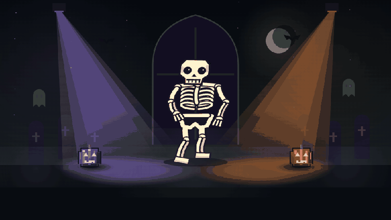

# Dr. Bones

An interactive Halloween party app where guests type requests and an AI model creates fun costumes, props and dance poses on the fly. An elastic, animated skeleton brings each change to life while dancing to music, with beat-synced lights and spooky background performers. Runs locally on Windows and is built for TVs and large displays.



## Features

- Live AI interaction turns guest requests into costumes, props and poses while preserving unrelated scene choices.
- Articulated 2D character with layered costumes, expressive poses and spring-based squash and stretch.
- Local beat tracking, synchronized stage lighting and automatic dance interludes with spooky background characters.
- Incremental text requests, instant presets, saved creations, undo and reset.
- Fullscreen party mode, quiet idle animation, adjustable dance speed and manual tempo controls.
- Optional AI scene creation, with local controls and validated JSON import available without an AI connection.

The automatic rotation includes comedic dance routines.

## Technology

| Component | Implementation |
| --- | --- |
| Frontend | Plain JavaScript ES modules, HTML and CSS; no frontend framework or build step. |
| Rendering | Canvas 2D with a hierarchical character rig, attached costume layers and bounded procedural choreography. |
| Audio | Web Audio API, AudioWorklet and a dedicated Web Worker for sample-timed audio capture and analysis. |
| Beat tracking | Three pretrained BeatNet CRNN models, an online particle filter and a smoothed presentation clock. |
| Model runtime | Bundled ONNX Runtime Web 1.30.0 using CPU WebAssembly/SIMD. |
| Backend | Node.js 22+ with built-in HTTP, cryptography, filesystem and streaming APIs. No server package dependencies. |
| Optional creative AI | Official OpenAI OAuth authorization, account-specific model discovery and streamed Responses API requests. |
| Storage and tests | Browser localStorage, Windows DPAPI-protected sign-in storage and Node's built-in test runner. |

Model weights and inference runtime files are included under `app/public/vendor/`; no package installation or model download is needed at startup. See [third-party notices](app/THIRD_PARTY.md) for versions, provenance and licenses.

Rendering, audio analysis and AI requests run separately so a slow creation request does not interrupt animation. AI output is restricted to validated scene data with limits on shapes, joint angles and keyframes; generated JavaScript is never executed.

## Run locally

Requires **Windows**, **Node.js 22+**, and a current **Edge or Chrome** browser.

Clone or download the repository, then double-click **Start Dr. Boner.cmd**. Alternatively, run:

```sh
node app/server.mjs --open
```

The party screen runs at `http://127.0.0.1:8788`. The console prints a private host-dashboard link with a temporary access code. Keep the console open while the app runs; stop it with Ctrl+C.

For laptop playback, click the speaker button and select a music tab or system-audio source with **Share audio** enabled. Microphone capture is also available. Captured audio is analyzed locally and is never recorded, uploaded or played back by the app. Beat tracking is approximate; manual BPM and tap tempo are available for difficult inputs.

## Optional AI connection

AI creation starts disabled and uses the official **Sign in with ChatGPT** integration where supported by the account. The host panel manages authorization, model selection and reasoning settings. Enabling AI requires confirmation that **credit use after included usage limits is off** in ChatGPT settings. There is no API-key billing or paid fallback path.

Only requested scene changes consume model allowance. Animation and music tracking remain local, and built-in controls continue working when AI is unavailable or usage limits are reached. Credentials stay in Windows-protected storage under `app/.local/`, excluded from Git and portable bundles.

## Development

```sh
node --test app/tests/*.test.mjs
```

Frontend modules are in `app/public/`, backend modules in `app/`, tests in `app/tests/`, and example scenes in `app/examples/`. See [verification notes](app/VERIFICATION.md) for test coverage, measurements and known limitations.
